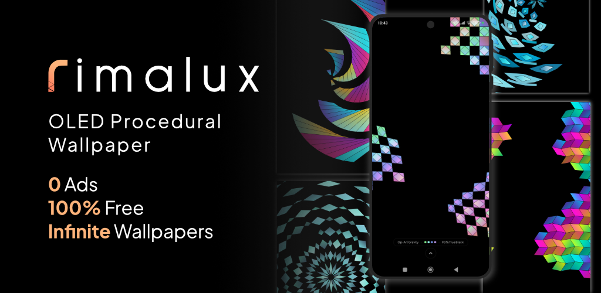
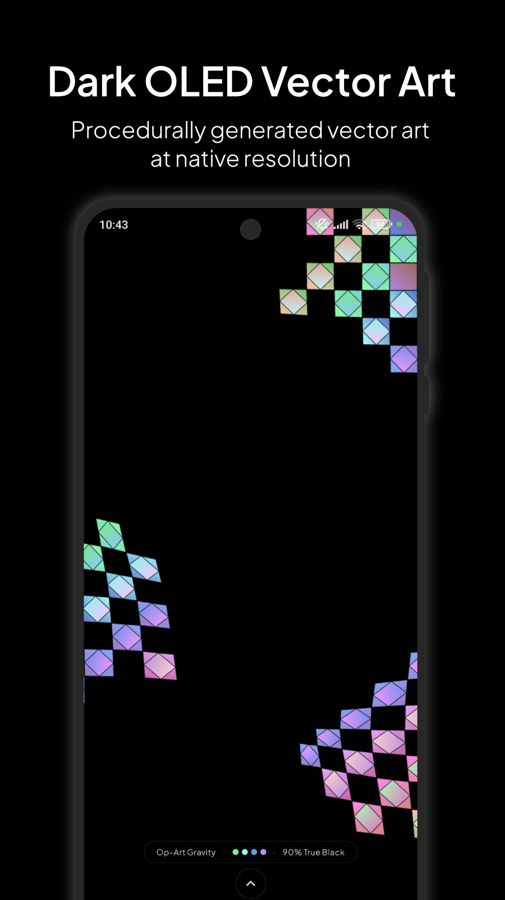
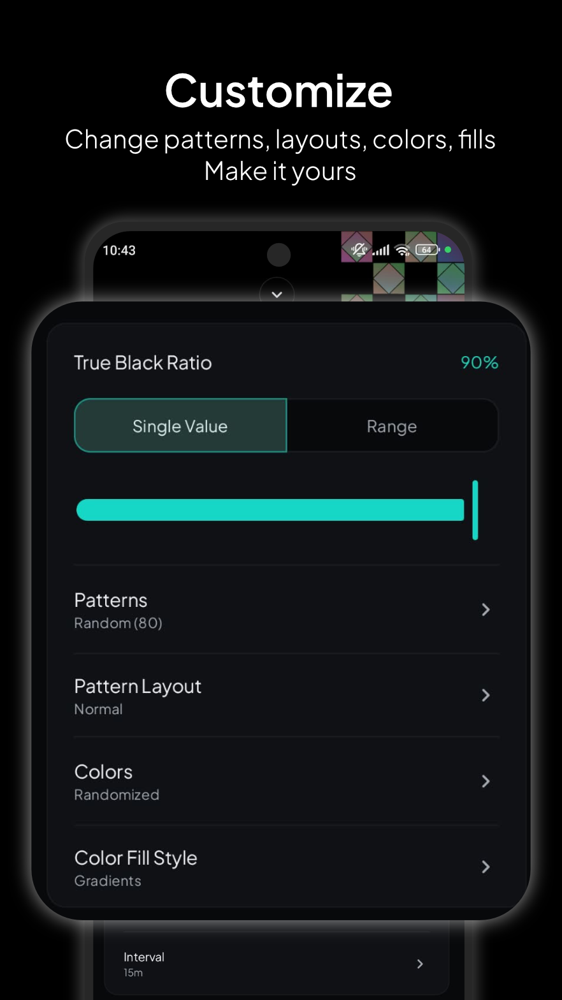
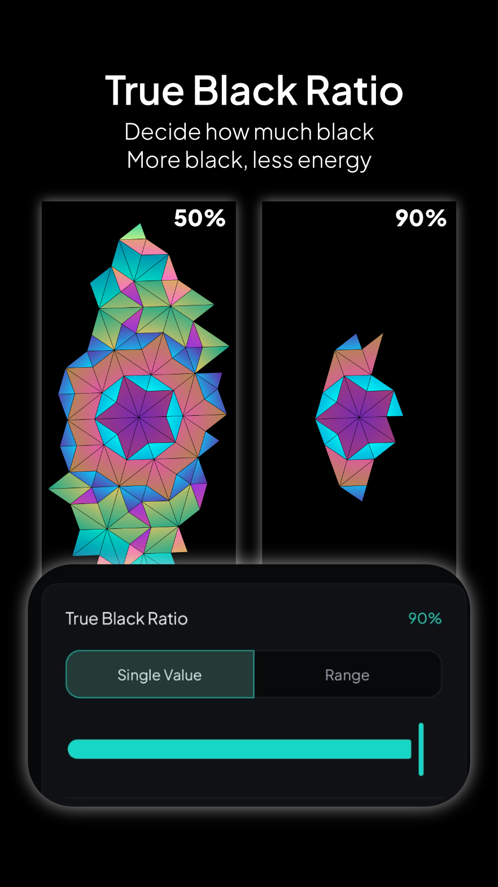
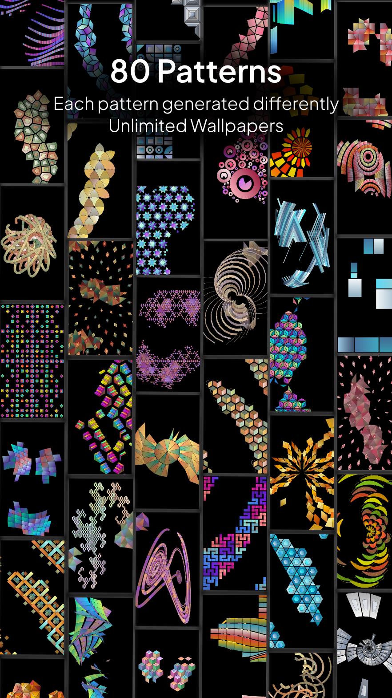
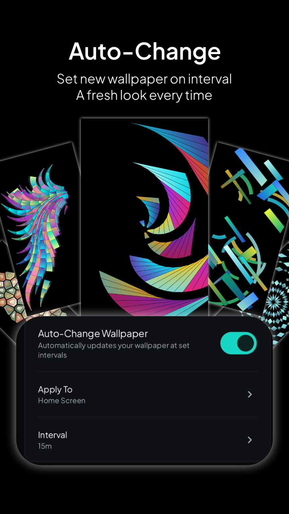
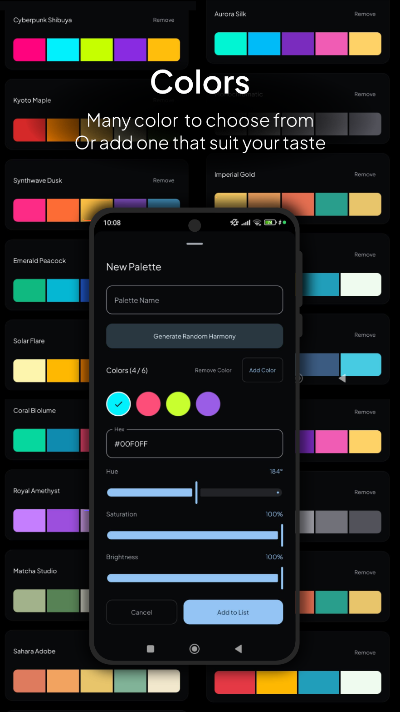
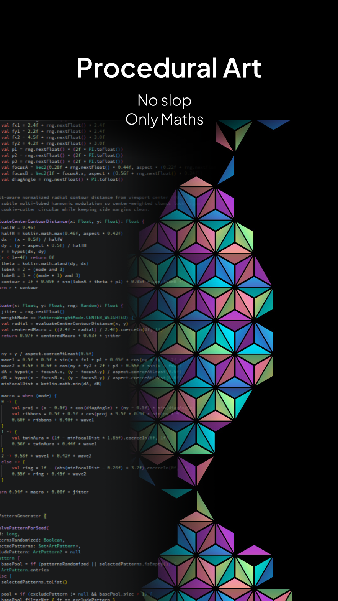

<!--
  Rimalux — User-Oriented Repository README
  Required Notice: Copyright 2026 Cptodix Studio
-->

   
  <table>
    <tr>
      <td width="112" align="center" valign="middle">
        
      </td>
      <td valign="middle">
        <h1 align="left">Rimalux</h1>
        

          <strong>Procedural OLED Vector Wallpapers — Zero Slop, Pure Mathematics.</strong> 
          Infinite, native-resolution wallpapers engineered for exact <code>#000000</code> True Black ratios, custom color harmonies, and effortless OLED battery savings. <strong>0 Ads · 100% Free.</strong>
        

      </td>
    </tr>
  </table>

  

    
    
    
    
    
  

   

  

    

  

  

    Direct Store Link: <a href="https://play.google.com/store/apps/details?id=com.cptodix.rimalux.oled.wallpaper">play.google.com/store/apps/details?id=com.cptodix.rimalux.oled.wallpaper</a>
  

<h2>✨ About Rimalux</h2>

  Most wallpaper apps recycle compressed static images or muddy AI renders that turn true blacks into battery-draining dark gray. <strong>Rimalux</strong> takes a completely different approach: <strong>every single wallpaper is generated mathematically in real time directly on your device</strong> using crisp vector geometry rendered at your screen's exact native resolution (up to 4K).

  Whether you want an ultra-minimalist lock screen with <strong>90% turned-off OLED pixels</strong> or a vivid algorithmic showcase across 80 distinct mathematical art systems, Rimalux gives you infinite, razor-sharp variety with <strong>zero ads, zero tracking, and zero bloat</strong>.

<ul>
  <li><strong>Exact True Black Ratio (<code>0%–95%</code>):</strong> Dial in an exact percentage—or let Rimalux vary within your chosen min/max range—calibrated pixel-by-pixel to pure <code>#000000</code> so OLED subpixels physically power down.</li>
  <li><strong>80 Procedural Mathematical Patterns:</strong> Four rich collections spanning <em>Flow &amp; Waves</em>, <em>Symmetry &amp; Sacred Geometry</em>, <em>Architectural Forms</em>, and <em>Tessellations &amp; Fractals</em>—each synthesized differently from every seed.</li>
  <li><strong>Normal &amp; Center Weighted Layouts:</strong> Spread patterns edge-to-edge across the display or clump geometry cleanly toward the center so app icons and edge widgets remain crisp and readable.</li>
  <li><strong>41 Curated Palettes + Random Harmonies + Custom Studio:</strong> Pick from 41 hand-tuned OLED palettes (including true Monochromatic), shuffle 8 HSV color-theory harmonies, or craft custom palettes with an HSB + Hex studio.</li>
  <li><strong>Instant Tap-to-Refresh &amp; A/B Comparison:</strong> Tweak a setting—like True Black Ratio, colors, fill style, or layout—and tap the refresh pill to update <em>only</em> what changed while keeping your current artwork intact. Swipe right anytime to compare before vs. after.</li>
  <li><strong>Resilient Background Auto-Change:</strong> Schedule automatic refreshes for Home Screen, Lock Screen, Both, or Separate Wallpapers every few minutes, hours, or day—complete with OEM battery-saver troubleshooting shortcuts.</li>
  <li><strong>Lossless PNG Export &amp; Smart Sharing:</strong> Save full-resolution unwatermarked PNGs to your gallery or share cleanly formatted artwork with an unobtrusive edge attribution tucked safely into the darkest pocket.</li>
</ul>

<h2>📱 Screenshots</h2>

  <table>
    <tr>
      <td align="center" width="25%" valign="top">
         
        <strong>Dark OLED Vector Art</strong> 
        Native-resolution vector geometry with infinite contrast
      </td>
      <td align="center" width="25%" valign="top">
         
        <strong>Full Studio Control</strong> 
        Patterns, layouts, colors, and Solid or Gradient fills
      </td>
      <td align="center" width="25%" valign="top">
         
        <strong>Exact True Black Ratio</strong> 
        Calibrate <code>#000000</code> coverage from 0% to 95%
      </td>
      <td align="center" width="25%" valign="top">
         
        <strong>80 Math Patterns</strong> 
        Unlimited combinations across 4 algorithmic families
      </td>
    </tr>
  </table>

  <table>
    <tr>
      <td align="center" width="33%" valign="top">
         
        <strong>Background Auto-Change</strong> 
        Refresh Home, Lock, or Both automatically on your schedule
      </td>
      <td align="center" width="33%" valign="top">
         
        <strong>Curated &amp; Custom Colors</strong> 
        41 OLED palettes, HSV harmonies, and HSB + Hex builder
      </td>
      <td align="center" width="33%" valign="top">
         
        <strong>Pure Mathematical Art</strong> 
        100% deterministic equations—zero AI slop, rendered locally
      </td>
    </tr>
  </table>

<h2>🧭 Quick User Guide</h2>

  Rimalux keeps the preview canvas 100% edge-to-edge so you judge every wallpaper full-screen first:

<table>
  <thead>
    <tr>
      <th align="left">Gesture / Action</th>
      <th align="left">What It Does</th>
    </tr>
  </thead>
  <tbody>
    <tr>
      <td><strong>Swipe Left</strong></td>
      <td>Generates or advances to the next fresh wallpaper using your active settings.</td>
    </tr>
    <tr>
      <td><strong>Swipe Right</strong></td>
      <td>Steps backward through recent wallpaper history (great for A/B comparison after tweaking settings).</td>
    </tr>
    <tr>
      <td><strong>Double-Tap</strong></td>
      <td>Opens the Apply &amp; Export menu: apply to <em>Home Screen</em>, <em>Lock Screen</em>, <em>Both</em>, <em>Both (Separate)</em>, <em>Save to Device</em> (lossless PNG), or <em>Share</em>.</td>
    </tr>
    <tr>
      <td><strong>Swipe Down</strong></td>
      <td>Cycles full-screen realistic <strong>Lock Screen</strong> and <strong>Home Screen</strong> icon overlays so you can check readability before applying.</td>
    </tr>
    <tr>
      <td><strong>Swipe Up</strong> (or tap handle)</td>
      <td>Reveals the Studio settings sheet for True Black Ratio, Patterns, Layouts, Colors, Fills, Auto-Change, and Language (<code>English</code> / <code>Bahasa Indonesia</code>).</td>
    </tr>
    <tr>
      <td><strong>Tap Settings Refresh Pill</strong></td>
      <td>When settings change, tap <em>"Settings updated · Tap here to refresh"</em> to update <strong>only</strong> what changed on the current wallpaper and archive the previous version to history.</td>
    </tr>
  </tbody>
</table>

  
<strong>🔋 Tips for Background Auto-Change on Aggressive Battery-Saving Devices (Xiaomi, Samsung, Oppo, Vivo, Realme, OnePlus)</strong>

   
  

    Android OEM battery optimizers can sometimes pause background wallpaper workers after a device sits idle. Inside the Studio sheet under <strong>Auto-Change Wallpaper → Not Changing Automatically?</strong>, Rimalux includes a built-in troubleshooting screen with brand-specific step-by-step instructions and direct shortcuts to your device's battery &amp; autostart settings.
  

<h2>🔒 Privacy, Permissions &amp; Specifications</h2>

<table>
  <thead>
    <tr>
      <th align="left">Specification</th>
      <th align="left">Details</th>
    </tr>
  </thead>
  <tbody>
    <tr>
      <td><strong>Minimum Android Version</strong></td>
      <td>Android 7.0 Nougat (API 24) through Android 16 (targetSdk 36)</td>
    </tr>
    <tr>
      <td><strong>Render Resolution</strong></td>
      <td>Native display resolution up to 4K UHD (<code>4096 px</code> max axis cap)</td>
    </tr>
    <tr>
      <td><strong>Languages</strong></td>
      <td>English (<code>en-US</code>), Bahasa Indonesia (<code>id-ID</code>) — auto-detected on first launch with manual switcher</td>
    </tr>
    <tr>
      <td><strong>Offline &amp; Privacy</strong></td>
      <td>100% on-device generation. No accounts, no analytics trackers, no ad SDKs, and zero broad media/storage read permissions.</td>
    </tr>
    <tr>
      <td><strong>Manifest Permissions</strong></td>
      <td><code>SET_WALLPAPER</code> (apply wallpapers), <code>RECEIVE_BOOT_COMPLETED</code> &amp; <code>WAKE_LOCK</code> (resilient Auto-Change scheduling), <code>WRITE_EXTERNAL_STORAGE</code> (<code>maxSdkVersion="28"</code> legacy gallery save only), <code>com.android.vending.BILLING</code> (optional tip jar).</td>
    </tr>
  </tbody>
</table>

<h2>🛠️ Technical Architecture &amp; Developer Docs</h2>

  Rimalux is built in <strong>Kotlin</strong> and <strong>Jetpack Compose (Material 3)</strong> with a strict separation between its <strong>100% pure-Kotlin procedural math core</strong> (<code>engine/</code>) and Android platform adapters (<code>platform/</code>, <code>ui/</code>, <code>scheduler/</code>, <code>data/</code>).

<ul>
  <li>📘 <a href="docs/PATTERNS_DIRECTORY.md"><strong>Patterns Directory</strong></a> — Complete catalog and function mapping of all 80 procedural mathematical patterns for cross-platform porting.</li>
  <li>🏗️ <a href="docs/ARCHITECTURE_AND_PORTING.md"><strong>Architecture &amp; Porting Guide</strong></a> — Pure-Kotlin core contracts, mathematical calibration equations, and platform adapter blueprints.</li>
  <li>🚀 <a href="docs/GITHUB_ACTIONS_PUBLISHING.md"><strong>GitHub Actions &amp; Play Publishing</strong></a> — Release signing (<code>.apk</code> / <code>.aab</code>) and Play Console CI setup.</li>
  <li>🤖 <a href="AGENTS.md"><strong>AGENTS.md</strong></a> — Engineering invariants, concurrency contracts, and regression checklist.</li>
</ul>

  
<strong>⚙️ Build &amp; Run Tests Locally</strong>

   
  
Requires JDK 17+ and Android SDK (<code>ANDROID_SDK_ROOT</code> configured). Use <code>gradle</code> to build or run the pure-JVM portability, mathematical calibration, and Robolectric Compose UI test suites:

  <pre><code># Build debug APK
gradle assembleDebug

# Run full unit, portability, pixel-calibration, and Robolectric UI test suite
gradle :app:testDebugUnitTest --console=plain</code></pre>

<h2>📜 License</h2>

  Rimalux is licensed under the <a href="LICENSE"><strong>PolyForm Perimeter License 1.0.1</strong></a>.

<blockquote>
  <strong>Required Notice: Copyright 2026 Cptodix Studio</strong>
</blockquote>

  You are free to inspect, build, learn from, and adapt the codebase under the terms of the PolyForm Perimeter License 1.0.1, provided you preserve required notices and obey the noncompete terms (do not distribute a competing product).

   
  Made with mathematics by <strong>Cptodix Studio</strong> · Zero Ads · Pure <code>#000000</code> OLED

